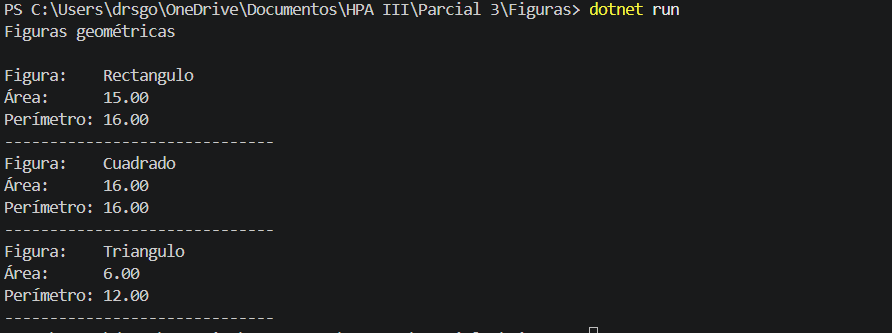
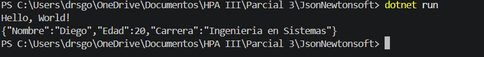
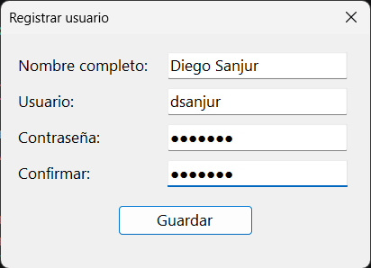
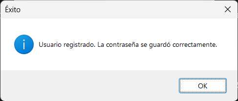
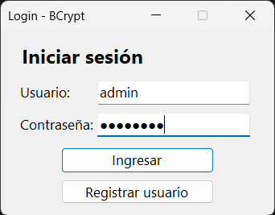
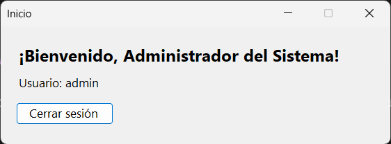
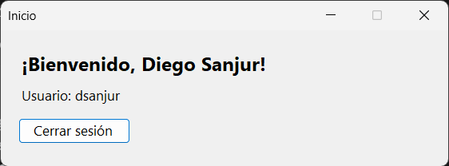
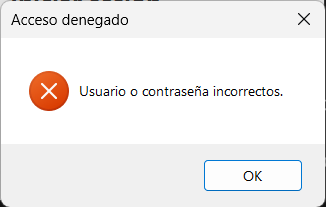
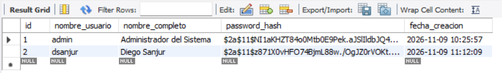
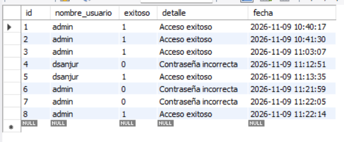

# Parcial #3 — Práctico

**Universidad Tecnológica de Panamá** — Facultad de Ingeniería de Sistemas Computacionales
Herramientas de Programación Aplicada III (.Net) · Grupo 1IL133 · II Semestre 2026

- **Estudiante:** Diego Sanjur
- **Facilitadora:** Irina Fong

---

## Descripción

Este repositorio contiene la parte práctica del Parcial #3, compuesta por tres programas independientes. El primero modela una jerarquía de figuras geométricas con una clase abstracta y la recorre de forma polimórfica; el segundo serializa un objeto a formato JSON con la biblioteca Newtonsoft.Json; y el tercero es un login en Windows Forms que almacena las contraseñas como hash con el algoritmo BCrypt sobre una base de datos MySQL.

El hilo común es la seguridad de tipos y la separación de responsabilidades: la clase abstracta obliga a cada figura a implementar su propio cálculo, el serializador convierte un objeto tipado en texto estándar, y el login separa el acceso a datos de la interfaz gráfica.

## Estructura del repositorio

```
Parcial-3-Diego-Sanjur/
├── Figuras/
│   └── Program.cs              Clase abstracta Figura, clases derivadas y recorrido polimórfico
├── JsonNewtonsoft/
│   └── Program.cs              Serialización de un objeto anónimo a JSON
├── LoginBCrypt/
│   ├── Program.cs              Punto de entrada de la aplicación
│   ├── UsuarioRepositorio.cs   Acceso a datos, hash y verificación con BCrypt
│   ├── FormLogin.cs            Ventana de inicio de sesión
│   ├── FormRegistro.cs         Registro de usuarios nuevos
│   └── FormPrincipal.cs        Bienvenida tras un acceso exitoso
├── capturas/                   Capturas de resultados de cada parte
└── parcial3_login.sql          Backup de la base de datos (estructura y datos)
```

---

## Parte 1: Figuras geométricas

Programa de consola que define la clase abstracta `Figura` con los métodos abstractos `CalcularArea()` y `CalcularPerimetro()`. Las clases `Rectangulo`, `Cuadrado` y `Triangulo` heredan de ella y sobrescriben ambos métodos con su propia fórmula; el triángulo calcula el área con la fórmula de Herón a partir de sus tres lados.

En `Main` se declara un arreglo unidimensional de tipo `Figura[]` que guarda una instancia de cada clase. Un `foreach` recorre el arreglo tratando cada objeto como `Figura`, y en tiempo de ejecución se invoca la implementación de la clase real, lo que se refleja al mostrar el nombre con `GetType().Name`.

**Conceptos:**
- Clase abstracta como molde obligatorio
- Métodos abstractos y `override`
- Arreglo unidimensional del tipo padre
- Polimorfismo y enlace dinámico

```
              ┌──────────────────────────────┐
              │      «abstract» Figura       │
              ├──────────────────────────────┤
              │ + CalcularArea(): double     │
              │ + CalcularPerimetro(): double│
              └──────────────▲───────────────┘
           ┌─────────────────┼─────────────────┐
┌──────────┴─────────┐ ┌─────┴──────────┐ ┌────┴───────────────┐
│     Rectangulo     │ │    Cuadrado    │ │     Triangulo      │
├────────────────────┤ ├────────────────┤ ├────────────────────┤
│ + Base: double     │ │ + Lado: double │ │ + LadoA: double    │
│ + Altura: double   │ │                │ │ + LadoB: double    │
│                    │ │                │ │ + LadoC: double    │
└────────────────────┘ └────────────────┘ └────────────────────┘
```



---

## Parte 2: JSON con Newtonsoft.Json

Programa de consola que intercambia los datos de una persona en formato JSON. Se instala el paquete con `dotnet add package Newtonsoft.Json`, se crea un objeto anónimo con las propiedades `Nombre`, `Edad` y `Carrera`, y `JsonConvert.SerializeObject()` lo convierte en una cadena JSON que se imprime en consola.

**Conceptos:**
- Paquetes NuGet
- Tipos anónimos con `var`
- Serialización de objetos a JSON



---

## Parte 3: Login con BCrypt

Aplicación de Windows Forms conectada a la base de datos MySQL `parcial3_login`. Al registrar un usuario, la contraseña se transforma con `BCrypt.HashPassword()` usando un factor de trabajo de 11, y en la tabla solo se guarda el hash. Al iniciar sesión se busca el hash del usuario y se compara con `BCrypt.Verify()`; si coincide, se abre una ventana que muestra el nombre completo del usuario.

Cada intento de acceso, exitoso o fallido, se registra en la tabla `intentos_login` con el usuario, el resultado, el motivo y la fecha, para un posible análisis posterior. Todas las consultas son parametrizadas para prevenir inyección SQL, y la propiedad `PasswordChar` solo oculta los caracteres en pantalla.

**Base de datos:**
- `usuarios`: id, nombre_usuario, nombre_completo, password_hash, fecha_creacion
- `intentos_login`: id, nombre_usuario, exitoso, detalle, fecha

**Conceptos:**
- Hash de contraseñas con BCrypt y factor de trabajo
- Verificación con `BCrypt.Verify()`
- Consultas parametrizadas con `MySqlCommand`
- Auditoría de accesos
- Formularios creados por código

```
┌─────────────────────────────────────────────┐
│        «static» UsuarioRepositorio          │
├─────────────────────────────────────────────┤
│ - CadenaConexion: string                    │
├─────────────────────────────────────────────┤
│ + RegistrarUsuario(usuario, nombre,         │
│                    password): bool          │
│ + IniciarSesion(usuario, password): Usuario?│
│ - RegistrarIntento(conexion, usuario,       │
│                    exitoso, detalle): void  │
└──────────────────────▲──────────────────────┘
                       │ usa
      ┌────────────────┴───────────────┐
┌─────┴──────────────┐   ┌─────────────┴──────┐   ┌────────────────────────┐
│     FormLogin      │   │    FormRegistro    │   │        Usuario         │
├────────────────────┤   ├────────────────────┤   ├────────────────────────┤
│ - txtUsuario       │   │ - txtNombre        │   │ + Id: int              │
│ - txtPassword      │   │ - txtUsuario       │   │ + NombreUsuario: string│
├────────────────────┤   │ - txtPassword      │   │ + NombreCompleto:string│
│ - BtnIngresar_Click│   │ - txtConfirmar     │   └────────────────────────┘
└─────────┬──────────┘   ├────────────────────┤
          │ abre         │ - BtnGuardar_Click │
┌─────────┴──────────┐   └────────────────────┘
│   FormPrincipal    │
├────────────────────┤
│ + FormPrincipal(   │
│   usuario: Usuario)│
└────────────────────┘
```

### Registro de usuario





### Inicio de sesión









### Base de datos




